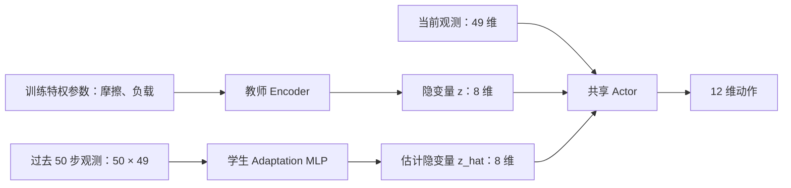
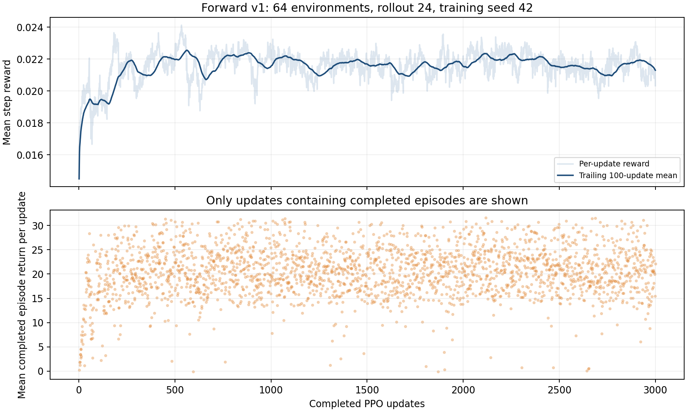

# Go2 RMA Locomotion Lab

基于 UniLab 的 Go2 强化学习运动控制实验：教师 PPO、历史观测适应、模型导出与 C++ 模拟部署。

> 当前状态：工程组件已有测试与运行记录；教师尚未学会稳定跟踪 0.5 m/s 前进指令。
> 本仓库保留失败结果和可复现的诊断，不声称完成鲁棒行走、真机部署或跨物理引擎泛化。

## 这个项目解决什么问题

目标是研究如何让四足机器人按速度指令运动，以及如何通过历史观测估计摩擦、负载相关的隐变量。
当前第一项任务是定位“策略原地踏步但没有向前移动”的原因。

**不知道下一步做什么时，先看 [项目工作流与当前步骤](PROJECT_WORKFLOW.md)。**



教师评估使用真实特权参数，学生使用历史估计隐变量；两条路径是分别选择的。
部署图只保留 Adaptation + Actor，教师 Encoder 与 Critic 不进入部署图。

本分支在 UniLab fork 中加入增量实验层，保留 `unilab` 导入，不修改上游项目的归属。
训练脚本使用项目内的独立 PPO 实现，不是官方 RSL-RL 的训练入口。

## 已观察到的结果

所有评估固定机体系指令 `(0.5, 0, 0)`，每个种子使用 8 个环境、每环境 1000 个控制步。

| 模型 | 评估种子 | 平均前向速度 (m/s) | 前向 RMSE (m/s) | 提前终止次数 |
|---|---:|---:|---:|---:|
| 原始教师 | 123 | -0.006058 | 0.510957 | 0 |
| 原始教师 | 456 | -0.011667 | 0.517436 | 1 |
| 原始教师 | 789 | -0.004922 | 0.511072 | 1 |
| 前进配置教师 v1 | 123 | 0.015686 | 0.489772 | 2 |
| 前进配置教师 v1 | 456 | 0.013730 | 0.490668 | 0 |
| 前进配置教师 v1 | 789 | 0.012254 | 0.491959 | 0 |

前进配置 v1 已完成 3000 次更新、4,608,000 次环境转移，初始化种子为 42。
三个评估种子不是三个独立训练种子，表格不构成跨训练种子的显著性结论。
不同配置使用不同奖励权重，因此不能直接用总奖励比较任务效果。
提前终止次数不是经独立检测标注的跌倒率。




原始数值、训练记录及分析见 [results](../../results/rma/) 和 [实验记录](../../experiments/rma/)。
曲线展示奖励而非实际速度；当前训练器尚未逐步记录前向速度曲线。

## 代码结构

```text
rsl_rl/unilab_rma/   教师/学生网络、PPO、GAE、历史缓冲与 UniLab 适配
scripts/             训练、评估、导出与结果汇总
legged_gym/          Go2 接口常量，并非重新实现 legged_gym
src/unilab/...       RMA 事件与任务配置；原有 UniLab 框架保持上游归属
deploy_cpp/          TensorRT 接口、双缓冲与 50/1000Hz mock 控制框架
tests/rma/           算法与接口测试
experiments/         问题、假设、对照设计与结论
results/             精选 JSON、CSV、配置记录与图表
docs/                使用说明、接口契约与复现边界
```

## 复现与依赖

完整说明见 [复现指南](REPRODUCING.md) 和 [验证记录](VALIDATION.md)。
逐步记录、画图与 Issue/PR 的分工见 [实验操作指南](EXPERIMENT_WORKFLOW.md)。

已发布的实测数据基于本地 UniLab 1.3.3 工作副本、MuJoCo CPU 物理环境和 PyTorch。
本 fork 基线为 UniLab 1.3.4，基线 commit 与关键文件差异见 [provenance.json](../../results/rma/provenance.json)。
原始运行副本未携带 Git 历史，且部分配置/运行时文件与 fork 不同；因此不能把旧实测冒充为当前分支端到端验证。
不建议为了运行本仓库直接升级已经验证过的仿真环境。

核心测试与结果图表可以独立运行；真实 Go2 训练仍需要完整 UniLab、依赖与机器人资产。
在匹配的环境中执行：

```bash
cd /path/to/this/UniLab
uv run --no-sync python -m unittest discover -s tests/rma -p 'test_*.py'
```

评估已存在的前进配置教师：

```bash
uv run --no-sync python scripts/evaluate_rma.py \
  --policy teacher --checkpoint runs/rma/teacher_forward_v1.pt \
  --task go2_joystick_flat/rma_forward \
  --num-envs 8 --steps 1000 --seed 123 \
  --command 0.5 0 0 --diagnostics
```

在上述命令追加 `--render` 可看画面，追加 `--render-speed 0.5` 可慢放。
训练默认不打开可视化。实验模型权重和已安装运行环境不包含在本仓库中。
以上是已有完整 1.3.3 运行环境的评估入口；1.3.4 环境接入必须单独完成兼容性验证。

## 接下来如何改进

1. 保留当前基线，补齐逐步速度、动作饱和和 PPO 更新诊断。
2. 在一致训练预算下分别检验指令范围、摆腿奖励和速度跟踪权重。
3. 教师速度跟踪通过后，比较学生自身 rollout 与教师表现。
4. 将 ONNX / TensorRT 的数值一致性与任务表现分别验收。

本仓库当前不是自动课程调度器；现有 `rma_forward` 是静态前进任务配置。
详细设计见 [下一项实验](../../experiments/rma/EXP-002_diagnosis_plan.md)。

## 来源与贡献范围

UniLab 是上游仿真与任务框架；本项目贡献范围为 RMA 增量实现、实验配置、诊断、导出/模拟部署及实验分析。
上游来源、许可证与本地源码快照的限制见 [来源说明](THIRD_PARTY_NOTICES.md)。
AI 工具参与了代码和文档辅助；已验证范围和未验证项以测试记录及实验数据为准。
