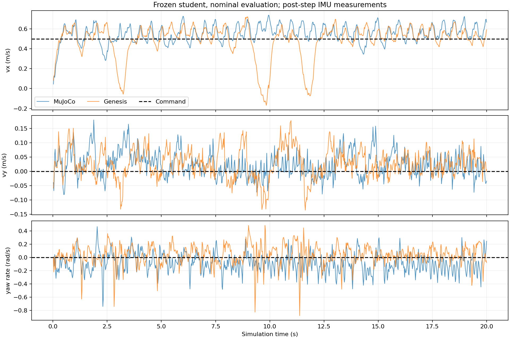
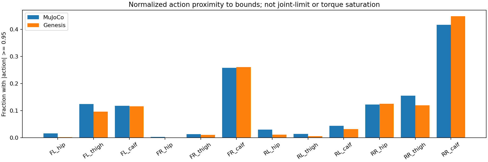
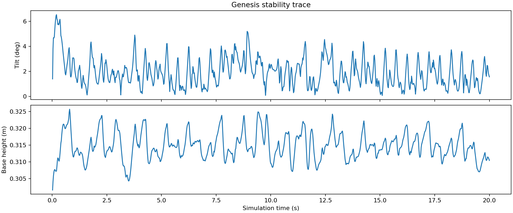

# EXP-006：冻结学生策略的 MuJoCo / Genesis 对照

- 日期：2026-10-24。
- 状态：完成单环境、单种子、1000 步的名义条件评估；仍需诊断速度波动。
- 问题：Go2 在 Genesis 可以前进，但肉眼观察到踉跄。
- 目标：先核对观测、控制与 reset 约定，再比较两个物理引擎的速度跟踪。
- 模型：`student_mapping_v1_500.pt` 与对应 ONNX；本实验不训练、不改变权重。
- 本次是接口修正后的对照，不是单变量奖励消融。多项接口修正同时存在，不能将结果归因于其中一项。

## 协议与需要保留的约定

两端使用 `--sim2sim-nominal`：home 初始姿态、零初始速度、观测噪声关闭，
机器人滑动摩擦系数 1.0、附加负载 0 kg、执行器 kp=35、kd=0；
被动关节阻尼 0.5 与执行器 kd 是不同参数。控制周期 0.02 s。
单环境，seed=123，1000 步，指令为前向 0.5 m/s、侧向 0、偏航角速度 0。
MuJoCo 初始回合计数清零；两端本次均在第 1000 步超时。

既有模型的重力输入来自负的 MJCF IMU site `framezaxis`，即世界坐标表达的 site z 轴取负。
本次 Genesis 保持该训练定义；不能直接替换成常见的机体坐标重力投影，否则改变冻结模型输入。
速度比较均使用动作执行后的 IMU 位置速度，Genesis 包含 IMU 偏移的角速度叉乘修正。

## 结果

来源：[comparison.json](../../results/rma/sim2sim/EXP-006/comparison.json)。
RMSE 按全程逐步误差计算，不是平均速度与指令之差。

| 指标 | MuJoCo | Genesis |
| --- | ---: | ---: |
| 平均前向速度，m/s | 0.552057 | 0.486771 |
| 前向速度 RMSE，m/s | 0.101833 | 0.165540 |
| 平面速度 RMSE，m/s | 0.112781 | 0.174903 |
| 平均侧向速度，m/s | 0.023105 | 0.027043 |
| 平均偏航角速度，rad/s | -0.086434 | 0.038306 |
| 跌倒或异常终止 | 0 | 0 |
| 右后小腿动作接近边界比例 | 41.7% | 44.9% |

### 速度跟踪

Genesis 平均前向速度接近指令，但约 3 s、9.5–10 s、11.5–12 s 存在明显降速。
平均达标不能代替逐步跟踪和 RMSE 检查。

### 动作分布

这里统计归一化动作 `|action| >= 0.95` 的比例，不能据此宣称机械限位或电机力矩饱和。
右后小腿是值得进一步检查的关节，但现有数据不能证明它导致降速。

### 姿态与高度

本次没有跌倒，但存在姿态与高度起伏。

## 结论与边界

支持：冻结策略已在另一物理引擎完成一次前进闭环，当前 Genesis 速度跟踪误差比 MuJoCo 大。
不支持：已证明任意初始状态下鲁棒、已定位踉跄根因、已达到真机部署验收。
home reset 且无噪声时，更换随机种子大多重复同一条件；不能把它当作充分的鲁棒性测试。
接触求解与积分仍有引擎差异，不能宣称两端动力学完全一致。

## 下一项最小工作

保持模型、奖励和控制参数不变，优先检查降速时段的足端接触、关节目标/实际角度、
执行器力矩及限幅。区分后端实际读数和 PD 代数估计，再决定是否开展单变量实验。

本次完整原始数据保留在 WSL：
`/home/abc/my_unilab/runs/rma/evaluations/sim2sim_nominal_v2_seed123`。
GitHub 精选证据、来源说明与复查方式见
[结果目录](../../results/rma/sim2sim/EXP-006/README.md)。
